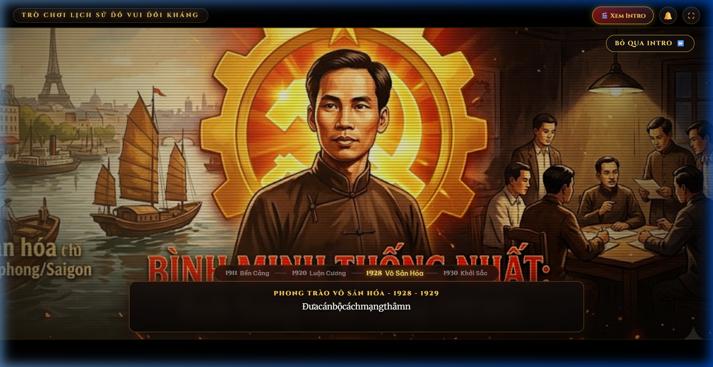
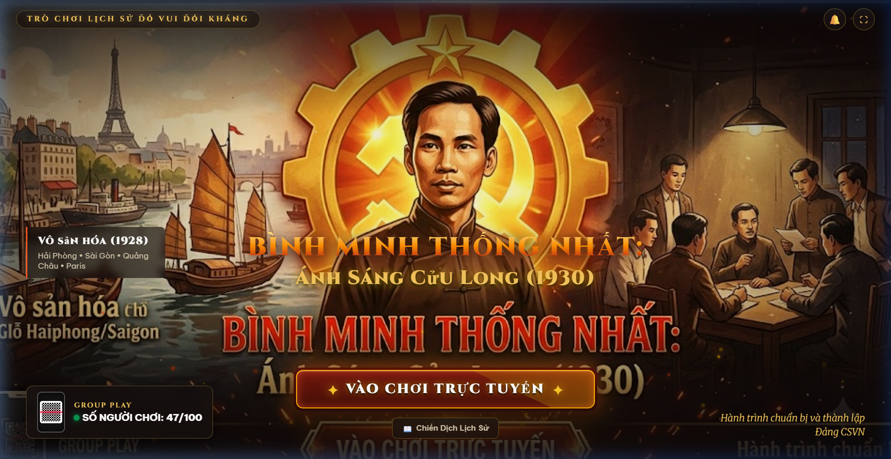
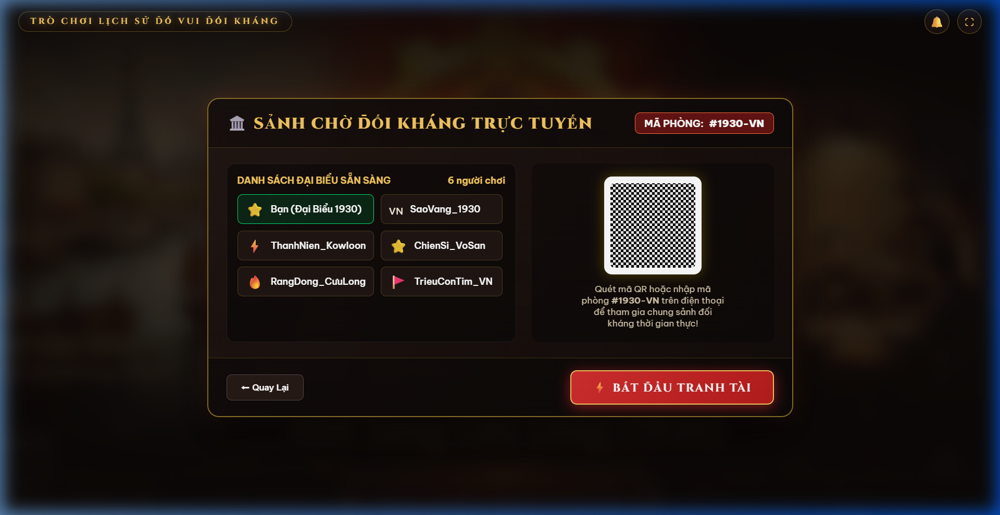
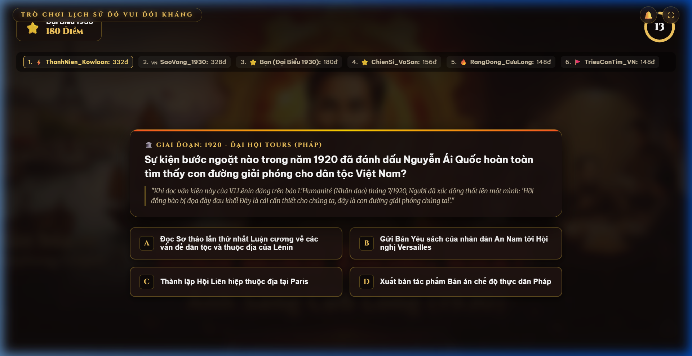
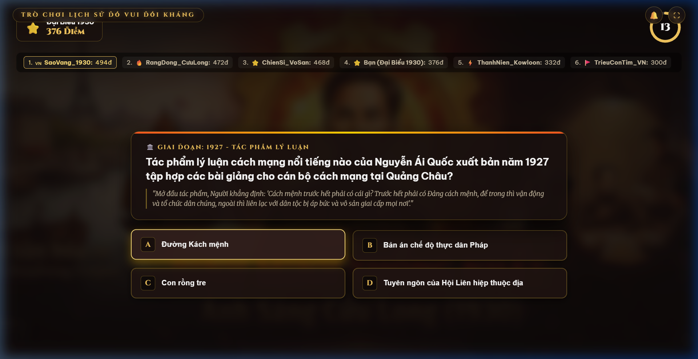
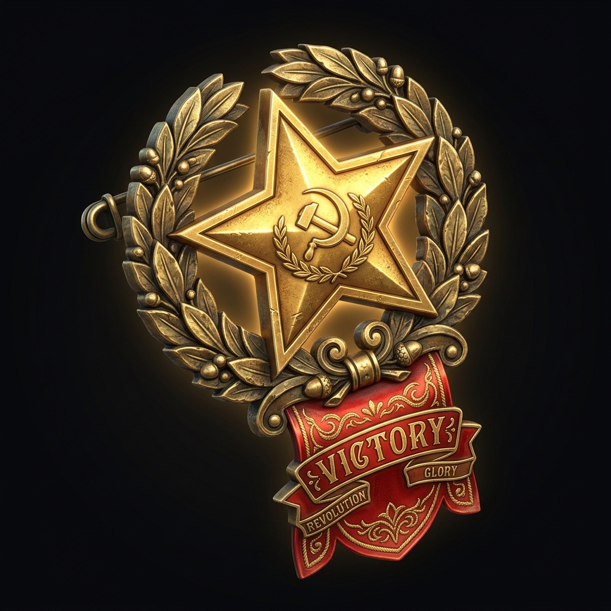

# 🌟 BÌNH MINH THỐNG NHẤT: ÁNH SÁNG CỬU LONG (1930)
## Trò Chơi Lịch Sử Đố Vui Đối Kháng Trực Tuyến 2.5D

> [!IMPORTANT]
> **Thư mục dự án đã tạo:** [binh-minh-thong-nhat-1930](file:///C:/Users/ADMIN/.gemini/antigravity-ide/scratch/binh-minh-thong-nhat-1930/)  
> **Địa chỉ trải nghiệm nội bộ:** [http://localhost:8080](http://localhost:8080) *(Máy chủ nền Node.js đang chạy)*  
> Khuyến nghị người dùng thiết lập thư mục `C:\Users\ADMIN\.gemini\antigravity-ide\scratch\binh-minh-thong-nhat-1930` làm không gian làm việc chính (**active workspace**).

---

### 1. Giới Thiệu & Bối Cảnh Lịch Sử

Trò chơi tái hiện giai đoạn lịch sử hào hùng chuẩn bị và thành lập **Đảng Cộng sản Việt Nam (1911 - 1930)**:
- **Trung tâm:** Đồng chí **Nguyễn Ái Quốc** thời trẻ (những năm 1930) với ý chí sắt đá, ánh mắt kiên định trước bánh răng công nghiệp, ngôi sao vàng và ngọn lửa búa liềm cách mạng.
- **Bên trái (Quá khứ & Sự chuẩn bị):** Bến cảng Nhà Rồng (1911), hành trình qua Paris, Quảng Châu và cao trào phong trào *"Vô sản hóa"* (1928) đưa cán bộ thâm nhập vào các nhà máy, hầm mỏ tại Hải Phòng, Sài Gòn, Nam Định, Hòn Gai.
- **Bên phải (Hội nghị hợp nhất Cửu Long):** Cuộc họp bí mật lịch sử dưới ánh đèn dầu tại bán đảo Cửu Long (Hương Cảng, Trung Quốc) từ ngày 6/1/1930 đến đầu tháng 2/1930 nhằm hợp nhất các tổ chức cộng sản thành một chính đảng duy nhất.

---

### 2. Các Tính Năng Kỹ Thuật & Thẩm Mỹ 2.5D

- **Video Intro Điện Ảnh Mở Màn (Cinematic Cutscene):**
  - Định dạng chuẩn màn ảnh rộng điện ảnh 2.39:1 Letterbox với hiệu ứng máy chiếu phim cổ điển (*film scratch & light leaks*).
  - Tái hiện 4 mốc son lịch sử chuyển cảnh chậm (*Ken Burns Pan/Zoom*):
    1. **1911 - Bến cảng Nhà Rồng:** Tàu buôn Đô đốc Latouche-Tréville rời bến trong sương sớm.
    2. **1920 - Paris (Pháp):** Người thanh niên Nguyễn Ái Quốc đọc Sơ thảo Luận cương của Lênin dưới ánh đèn bàn.
    3. **1928 - 1929 - Phong trào Vô sản hóa:** Đưa cán bộ vào sâu trong hầm mỏ, đồn điền Hải Phòng, Sài Gòn.
    4. **1930 - Cửu Long (Hương Cảng):** Hội nghị hợp nhất lịch sử khai sinh Đảng Cộng sản Việt Nam.
  - Lời thuyết minh dạng điện tín gõ máy typewriter tự động đồng bộ theo từng phân cảnh.
  - Tích hợp nút **"🎬 Xem Intro"** trên thanh điều khiển và nút **"BỎ QUA INTRO ⏩"** mượt mà.
- **Hiệu ứng thị sai 2.5D (Parallax Perspective):** Lớp tranh nền phản hồi mượt mà theo chuyển động chuột hoặc con trỏ của người chơi, tạo độ sâu trường ảnh điện ảnh.
- **Hệ thống hạt Canvas thời gian thực (Atmospheric FX):**
  - Hơn 60 hạt tàn lửa cách mạng (*revolutionary sparks*) bốc lên cuồn cuộn từ đáy màn hình.
  - Hạt bụi lịch sử (*vintage dust motes*) lơ lửng trong luồng sáng vàng.
  - Hiệu ứng ánh sáng đèn dầu chớp nháy (*kerosene lamp flicker*) tại gian phòng họp bí mật bên phải.
- **Hệ thống âm thanh Web Audio API độc lập:** Tự động tổng hợp âm thanh kèn khải hoàn, tích tắc đồng hồ đếm ngược, chuông trả lời đúng ngân vang mà không phụ thuộc file âm thanh ngoài.
- **Cơ chế thi đấu Multiplayer đối kháng thời gian thực:**
  - Sảnh chờ trực tuyến với mã phòng `#1930-VN` và hiển thị thời gian thực người chơi.
  - Thanh bảng xếp hạng trực tiếp giữa người chơi và các đối thủ ảo (*SaoVang_1930, ThanhNien_Kowloon, ChienSi_VoSan...*).
  - Hệ thống tính điểm tốc độ, chuỗi Combo streak thưởng điểm và kho tư liệu giải nghĩa lịch sử sau mỗi câu hỏi.

---

### 3. Hình Ảnh & Video Trải Nghiệm Thực Tế

````carousel

<!-- slide -->

<!-- slide -->

<!-- slide -->

<!-- slide -->

<!-- slide -->

````

---

### 4. Cấu Trúc Mã Nguồn

| Tập tin | Chức năng |
| :--- | :--- |
| [index.html](file:///C:/Users/ADMIN/.gemini/antigravity-ide/scratch/binh-minh-thong-nhat-1930/index.html) | Khung giao diện HTML5 chuẩn SEO, tích hợp 4 màn hình (Start, Lobby, Battle, Podium) |
| [style.css](file:///C:/Users/ADMIN/.gemini/antigravity-ide/scratch/binh-minh-thong-nhat-1930/style.css) | Toàn bộ hệ thống thiết kế Vanilla CSS, phông chữ Cinzel & Merriweather, hiệu ứng tia lửa |
| [app.js](file:///C:/Users/ADMIN/.gemini/antigravity-ide/scratch/binh-minh-thong-nhat-1930/app.js) | Điều phối trạng thái game, giả lập đối thủ thi đấu, tính điểm combo, xử lý tương tác |
| [questions.js](file:///C:/Users/ADMIN/.gemini/antigravity-ide/scratch/binh-minh-thong-nhat-1930/questions.js) | Ngân hàng câu hỏi lịch sử chuẩn xác về hành trình từ 1911 đến Hội nghị Cửu Long 1930 |
| [particles.js](file:///C:/Users/ADMIN/.gemini/antigravity-ide/scratch/binh-minh-thong-nhat-1930/particles.js) | Engine hạt Canvas vẽ tàn lửa cách mạng và ánh sáng đèn dầu |
| [sound.js](file:///C:/Users/ADMIN/.gemini/antigravity-ide/scratch/binh-minh-thong-nhat-1930/sound.js) | Bộ tổng hợp âm thanh Web Audio API mô phỏng tiếng kim đồng hồ và kèn khải hoàn |
| [server.js](file:///C:/Users/ADMIN/.gemini/antigravity-ide/scratch/binh-minh-thong-nhat-1930/server.js) | Máy chủ tĩnh Node.js phục vụ cục bộ |
